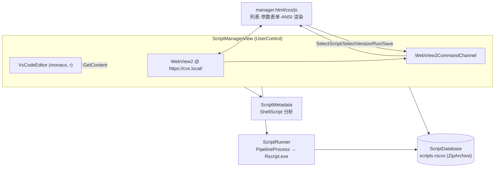

## 产品概述

在 `src\RDev\RDev.NET5.vbproj`（VB.NET WinForms，net10.0-windows）中新增 `CVS` 子模块：一个 R# 脚本版本管理器。它以单个自定义 zip 包（`%LOCALAPPDATA%\RDev\scripts.rscvs`）作为数据库，保存脚本的多个版本、每版本的元数据（标题/作者/描述/依赖/命令行参数）以及每次运行的记录（工作目录、命令行参数、标准输出、标准错误、退出码、耗时）。界面为可嵌入的 UserControl：左侧 WebView2 承载嵌入式 HTML 页面（VS Code 亮色主题）做列表浏览与运行参数表单，右侧复用 `VsCodeEditor.vb` 做脚本代码编辑；保存时若代码有变更即生成新版本。

## 核心功能

- **zip 数据库**：脚本列表 → 版本列表 → 运行历史的三级数据；索引 `index.json` + 按脚本/版本分目录存放 `code.R`、`version.json`、`runs/*.json` 与 `.out.txt` / `.err.txt`；首次使用自动创建。
- **三级浏览界面**：HTML 页面左侧列出所有脚本，点击脚本显示其历史版本列表，点击版本显示该版本的运行历史（工作目录、命令行参数列表、标准输出、标准错误）。
- **ANSI 渲染**：标准输出/标准错误中的 ANSI SGR 转义序列在 HTML 端被解析为带 CSS 类的彩色/加粗/斜体/下划线文本，其余控制序列（光标移动、OSC）被安全剥离。
- **编辑与版本化**：点击某版本把脚本文本读入 `VsCodeEditor`；保存时与当前版本正文比对，有变更才写入新版本，版本号形如 `yyyy-MM-dd-xxx`（xxx 为数据库级自增 UInteger 序号）。
- **元数据解析**：用 `SMRUCC.Rsharp.Development.CommandLine.ShellScript` 分析脚本，抽取命令行参数（名称/类型/默认值/说明/是否必填）与标题、作者、描述、包依赖，生成参数表单。
- **内置运行**：按表单参数调用 Rscript.exe 执行脚本，捕获 stdout/stderr/退出码/耗时，运行结束自动入库并在界面上刷新历史。

## 边界说明（已确认）

- 只交付 UserControl，不建 Form 外壳、不改 RsharpDev 宿主；数据库固定为 `%LOCALAPPDATA%\RDev\scripts.rscvs`；HTML 只做列表 + 元数据/参数表单 + 输出展示，脚本正文编辑统一走 `VsCodeEditor`。

## 技术栈

- 语言/框架：VB.NET（net10.0-windows，WinForms，RootNamespace `RDev`），沿用工程既有约定（默认 glob 编译 `CVS\**\*.vb`）
- Web 层：Microsoft.Web.WebView2 1.0.2950+（工程已引用 1.0.4258.31）+ 原生 HTML/CSS/JS（无前端框架）
- 宿主通信：共享项目 `galaxy\src\WebViewHelper` 的 `WebViewLoader.Init` 与 `WebView2CommandChannel`（`{type,payload}` + `PostWebMessageAsJson`）
- 脚本元数据：`SMRUCC.Rsharp.Development.CommandLine.ShellScript`（`Rscript.FromText` → `New ShellScript(...).AnalysisAllCommands().GetDocument()`）
- 脚本执行：`Microsoft.VisualBasic.CommandLine.PipelineProcess.Call(app, args, ByRef stdErr, ByRef exitCode, workdir)`
- 存储：`System.IO.Compression.ZipArchive`（FileStream + Update 模式），JSON 用 `System.Text.Json`
- 编辑器：复用 `RDev.VsCodeEditor`（monaco，language=`r`，主题 `vs`）

## 实现方案

以「DB 引擎 / 元数据解析 / 运行器 / 前端资产 / 控件宿主」五层拆分，全部落在 `src\RDev\CVS`。

1. **zip DB 引擎（写入侧不用 `ZipStream`）**：已确认 `Microsoft.VisualBasic.ApplicationServices.Zip.ZipStream` 的 `GetFileEntry` 依赖构造期一次性构建的 `FileSystemTree`，新 `CreateEntry` 的条目不会进树，二次读取会误判缺失甚至重复建条目。因此 DB 直接用 `New FileStream(path, FileMode.OpenOrCreate, FileAccess.ReadWrite, FileShare.None)` + `New ZipArchive(fs, ZipArchiveMode.Update)`，自管条目全名（`/` 分隔），所有公开方法 `SyncLock` 串行化，`Dispose` 时 Flush 落盘。覆写条目统一「先 `GetEntry`→`Delete()`，再 `CreateEntry()`」。
2. **版本号**：DB 级 `nextSerial As UInteger`（存在 `index.json`），不按天重置；`{yyyy-MM-dd}-{serial}`（serial 至少 3 位零填充，超过 999 自然加宽）。保存时用 `codeHash`（SHA256 前 16 位 + 长度）或直接正文比对，未变更则返回 `Nothing` 不建版本。
3. **前端资产托管**：完全照抄 `VsCodeEditor.vb` 的模式——虚拟域 `https://cvs.local/` + `AddWebResourceRequestedFilter("https://cvs.local/*", All)` + `OnWebResourceRequested` 里 `GetDeferral()` 并按 `LocalPath` 分发 html/css/js（均从嵌入式资源按**后缀**匹配读取，`GetManifestResourceNames().EndsWith(suffix, OrdinalIgnoreCase)`），`Finally def.Complete()`。
4. **消息协议**：host→page 用 `Send("Scripts"/"Versions"/"Runs"/"VersionDetail"/"RunResult"/"Status", payload)`；page→host 用 `window.chrome.webview.postMessage`。命令在页面 `Ready` 前排队（`_pending`/`FlushPending`，与 VsCodeEditor 同款），避免竞态。
5. **运行链路**：`Task.Run` 后台线程 → 导出当前版本正文到临时 `.R`（`%LOCALAPPDATA%\RDev\tmp\{versionId}.R`，UTF8 无 BOM）→ 拼命令行 `"<script.R>" --name "value" ...`（布尔开关用 `--flag`）→ `PipelineProcess.Call(..., workdir:=...)` → 写库 `AddRun` → `Control.Invoke` 回传前端刷新并抛 `RunCompleted` 事件。`RscriptPath` 可配置（默认候选：宿主目录 `Rscript.exe` / `R#.exe` / 环境变量 `RSCRIPT_HOME`），缺失时给出明确状态提示而不是静默失败。
6. **性能与体量控制**：`index.json` 只放脚本清单与计数器，版本/运行明细按条目分散读写，避免每次保存重写大 JSON；stdout/stderr 按条目单独存储，列表查询只读 `*.json`（不载入输出文本），点击某条运行历史时才读取 `.out.txt`/`.err.txt`；输出文本超长（>1MB）时前端截断渲染并提示可复制全文。

## 实现要点（防坑）

- `WebView2CommandChannel.Send` 内部是 `PostWebMessageAsJson`，**必须在 UI 线程调用**；后台线程一律经 `Control.Invoke`/`SynchronizationContext.Post` 回传。
- `ShellScript` 构造与分析可能抛异常（语法错误、`DuplicateNameException`），`ScriptMetadata.Parse` 必须 Try/Catch 降级为「空参数列表 + 首行注释作标题」。
- 嵌入资源：vbproj 需同时 `<None Remove="CVS\web\*.*" />` 与 `<EmbeddedResource Include="CVS\web\manager.html|manager.css|manager.js" />`（照抄现有 `vscode\editor.js` 写法）；清单资源名带项目根前缀，故只能按后缀匹配。
- VB 陷阱：保留字参数用方括号（`[error]`、`[Imports]`、`[Call]`）；`Async Sub` 内异常会吞掉，事件处理用 `Try/Catch` 包住并回传 `Status`。
- RDev 是类库（无启动窗体），本次不做宿主集成，只保证编译通过 + 控件可实例化。

## 架构设计



数据流：页面事件 → 宿主查询 `ScriptDatabase` → 回传 JSON 渲染；选中版本 → `db.GetVersionCode` → `vscode.SetContent(code,"r")`；保存 → `Await vscode.GetContent()` → 比对 → `db.SaveVersion`（新增版本 + `ScriptMetadata` 重算）→ 刷新；运行 → `ScriptRunner` 导出临时脚本并调用 Rscript.exe → `db.AddRun` → 回传 `RunResult`。

## 目录结构

```
src/RDev/
├── RDev.NET5.vbproj                          # [MODIFY] 新增 CVS\web\manager.html / manager.css / manager.js 的 EmbeddedResource（配 <None Remove>）
├── CVS/
│   ├── Models.vb                             # [NEW] ScriptRecord / VersionRecord / RunRecord / ScriptMetadata / ArgumentSpec 数据契约（System.Text.Json 友好：Property + 默认值）
│   ├── CvsDatabase.vb                        # [NEW] zip 数据库引擎：Open/DefaultPath(%LOCALAPPDATA%\RDev\scripts.rscvs)/Create、ListScripts、AddScript、SaveVersion(变更新版本)、GetVersionCode、ListVersions、AddRun、ListRuns、ReadOutput、Delete 支持、Dispose 落盘；内部 ZipArchive + SyncLock
│   ├── ScriptMetadata.vb                     # [NEW] Shared Parse(code) → ScriptMetadata；基于 ShellScript.AnalysisAllCommands().GetDocument()，容错降级
│   ├── ScriptRunner.vb                       # [NEW] RscriptPath 解析与可配置；ExportTempScript；BuildArgumentLine(args)；RunAsync(version, code, args, workdir) → RunRecord（stdout/stderr/exitCode/durationMs）
│   ├── CvsProtocol.vb                        # [NEW] 前后端消息 type 常量（Outgoing: Ready/SelectScript/SelectVersion/OpenInEditor/SaveVersion/RunScript/NewScript/DeleteScript；Incoming: Scripts/Versions/Runs/VersionDetail/RunResult/Status）与 payload 字典辅助构造
│   ├── ScriptManagerView.vb                  # [NEW] UserControl 主体：WebView2 初始化、OnWebResourceRequested 托管嵌入式页面、OnWebMessageReceived 分发、VsCodeEditor 联动（打开版本/保存新版本）、后台运行与 UI 回传、事件 ScriptSaved/VersionCreated/RunCompleted/StatusMessage
│   ├── ScriptManagerView.Designer.vb         # [NEW] SplitContainer（Panel1 WebView2 / Panel2 VsCodeEditor）+ 精简 ToolStrip（新建脚本/保存版本/运行/刷新）
│   ├── ScriptManagerView.resx                # [NEW] 设计器资源
│   └── web/
│       ├── manager.html                      # [NEW] 三栏布局：脚本列表 / 版本列表 / 详情（元数据卡 + 参数表单 + 运行历史 + stdout/stderr 面板）
│       ├── manager.css                       # [NEW] VS Code Light+ 主题变量与组件样式，含 ANSI 前景/背景/粗体/斜体/下划线 CSS 类
│       └── manager.js                        # [NEW] 消息桥、列表与表单渲染、ANSI→HTML 解析（SGR 30-37/90-97/40-47/100-107、1/3/4/9、0/39/49 复位，剥离光标/OSC，先 HTML 转义防注入）
```

## 关键代码结构

```
Namespace CVS
    ' 数据库中的一条版本记录（version.json）
    Public Class VersionRecord
        Public Property versionId As String          ' yyyy-MM-dd-xxx
        Public Property serial As UInteger           ' 自增序号
        Public Property scriptId As String
        Public Property parentVersionId As String
        Public Property created As String            ' ISO8601
        Public Property comment As String
        Public Property codeLength As Long
        Public Property codeHash As String
        Public Property metadata As ScriptMetadata   ' 标题/作者/描述/依赖/命令行参数
    End Class

    ' 一次运行历史（runs/{runId}.json，输出文本另存 .out.txt / .err.txt）
    Public Class RunRecord
        Public Property runId As UInteger
        Public Property versionId As String
        Public Property time As String
        Public Property workdir As String
        Public Property arguments As Dictionary(Of String, String)
        Public Property exitCode As Integer
        Public Property durationMs As Long
        Public Property success As Boolean
        Public Property stdoutSize As Long
        Public Property stderrSize As Long
    End Class
End Namespace
```

```javascript
// manager.js 侧消息契约（与 CvsProtocol.vb 一一对应）
const Outgoing = { Ready:"Ready", SelectScript:"SelectScript", SelectVersion:"SelectVersion",
                   OpenInEditor:"OpenInEditor", SaveVersion:"SaveVersion", RunScript:"RunScript",
                   NewScript:"NewScript", DeleteScript:"DeleteScript" };
const Incoming = { Scripts:"Scripts", Versions:"Versions", Runs:"Runs",
                   VersionDetail:"VersionDetail", RunResult:"RunResult", Status:"Status" };
// ANSI：/(\x1b\[[0-9;]*m)/ 切分 → span(class="fg-red bold")，文本先做 & < > " 转义
```

## 应用类型与布局

Windows 桌面端 WinForms 宿主内的 Web 面板（非移动端）。UserControl 用竖向 SplitContainer：左栏 WebView2（默认 38% 宽，最小 320px），右栏 monaco 编辑器；顶部一条 32px 高的精简工具栏（新建脚本 / 保存版本 / 运行 / 刷新）。Web 面板内部再分三栏：脚本列表（固定 26%）、版本列表（固定 30%）、右侧详情区（自适应）。

## 页面分块设计（单页三栏）

1. **顶部标题条**：产品名 "R# Script CVS" + 数据库路径 + 右侧状态胶囊（就绪/运行中/失败）。浅灰 #F3F3F3，1px 下边框，标题 13px 600。
2. **脚本列表栏**：搜索框 + 列表项（脚本名 + 更新时间 + 最新版本徽标）。悬停 #E8E8E8，选中项左侧 2px 蓝色指示条 + #C9C9C9 底；空态居中提示"暂无脚本，点击新建"。
3. **版本列表栏**：版本号 `yyyy-MM-dd-xxx` 主行 + 变更说明次行 + 时间右对齐；当前在编辑器中打开的版本带"当前"徽章；顶部按钮"保存新版本""在编辑器中打开"。
4. **详情区-元数据卡**：标题、作者、描述、包依赖（胶囊标签），键名灰色弱化，值可换行，整卡白底 1px 边框圆角 4px。
5. **详情区-参数表单**：由元数据自动生成的输入框（文本/数字/布尔开关），每个参数显示类型与"必填/默认"提示；底部工作目录输入框（带浏览回调）与"运行"主按钮（#007ACC）。
6. **详情区-运行历史**：时间线列表（时间 + 退出码徽标 + 耗时 + 工作目录），展开后为两个标签页（stdout / stderr），内容为等宽终端区：黑底不适用，采用浅色终端（白底 #FFFFFF、1px 边框、Consolas 12.5px），ANSI 序列渲染为对应颜色/粗体/斜体/下划线，长输出底部显示"已截断，可复制全文"。

## 视觉风格

VS Code Light+ 风格：纯白内容区、#F8F8F8 侧栏、#E5E5E5 细分隔线、#007ACC 焦点蓝；无阴影堆叠、直角偏 4px 圆角、1px 细描边；所有过渡 120ms ease；列表项选中/悬停即时反馈；运行按钮运行中显示脉冲微动画与禁用态。

## 响应式与可访问性

面板窄于 900px 时版本栏折叠为详情区上方横条；终端区 `overflow:auto` + `white-space:pre`；stderr 行以 #CD3131 语义色区分，退出码非 0 用 #CD3131 徽标、0 用 #107C10 徽标；键盘可达（Tab 顺序、Enter 运行），禁用态有对比度保证。

## Agent Extensions

### SubAgent

- **code-explorer**
- Purpose：实现阶段核对 `ShellScript`/`CommandLineDocument`/`PipelineProcess.Call` 的精确签名与命名空间，以及 scibasic# 中 `%LOCALAPPDATA%` 相关路径助手的现成写法，避免 API 误用。
- Expected outcome：得到可直接抄用的 Imports 路径与调用签名清单，DB/元数据/运行器三处代码一次编译通过。